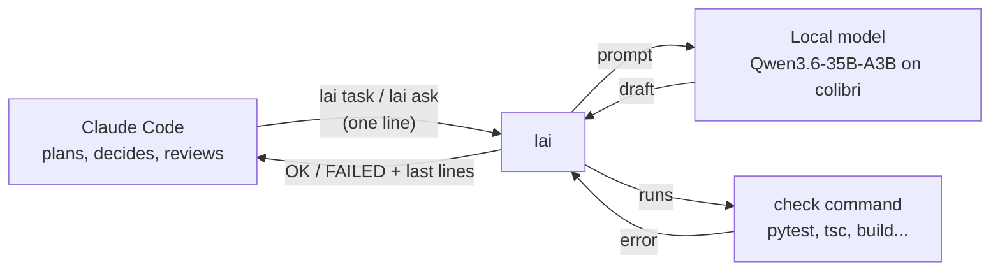

# Local-AI

**Claude orchestrates, a local model does the heavy lifting.**

`lai` is a small command-line tool that lets [Claude Code](https://claude.com/claude-code)
hand token-hungry work to an LLM running on your own GPU, so a $20/month Claude
plan lasts much longer. Claude keeps the decisions; the local model reads the
huge files, writes the first drafts and fixes its own mistakes until the tests pass.

An example run (timings illustrative):

```text
$ lai task tests/test_dates.py \
    -i "pytest tests for parse_date: valid formats, invalid input, empty string" \
    -c "pytest tests/test_dates.py" --context src/dates.py
[lai     0s] attempt 1/3: generating tests/test_dates.py
[lai    41s] attempt 1/3: running `pytest tests/test_dates.py`
[lai    43s] attempt 2/3: generating tests/test_dates.py
[lai    79s] attempt 2/3: running `pytest tests/test_dates.py`
OK: tests/test_dates.py passes `pytest tests/test_dates.py` (attempt 2)
```

Claude wrote one line and read one line. The two drafts, the failing run and the
fix never entered its context.

## The idea

Subscription plans for frontier models are metered by usage, and an agent like
Claude Code spends most of it **reading**: whole files, long logs, its own drafts.
Delegating to a local model only saves anything if Claude **doesn't read the
local model's output**, so `lai` is built around three rules:

1. **The local model reads, Claude gets the summary.** `lai ask` turns a
   5,000-line log into ten relevant lines. Inputs larger than the local model's
   context are split, condensed part by part, and answered from the notes.
2. **Output goes to disk, not to the conversation.** `lai task` and
   `lai ask --out` write files and print a single status line.
3. **Checks are the referee, not Claude's eyes.** `lai task` runs a command
   (tests, a type checker, a build) after each draft and feeds the failure back
   to the local model. Claude only steps in when it still fails after N attempts.
   On failure the original file is restored and the last draft is kept as
   `<file>.lai-failed`.



## Hardware and model

Built for this setup (real-hardware numbers pending, see the roadmap):

| | |
|---|---|
| GPU | AMD Radeon RX 6700 XT (12 GB), through Vulkan |
| RAM | 32 GB |
| Local model | [Qwen3.6-35B-A3B](https://huggingface.co/Qwen/Qwen3.6-35B-A3B), a mixture-of-experts model with reasoning ("thinking") and tool use |
| Inference engine | [colibri](https://github.com/JustVugg/colibri): keeps the hottest experts on the GPU, the rest in RAM |
| Orchestrator | Claude Code on a Claude Pro subscription |

`lai` talks to any **OpenAI-compatible** server, so llama.cpp, LM Studio,
Ollama or vLLM work as well. Set `LAI_BASE_URL`.

## Install

Requires Python 3.10+ and nothing else (standard library only).

```bash
git clone https://github.com/IsaacDSDS/Local-AI.git
cd Local-AI
pipx install -e .      # puts `lai` on your PATH
lai status             # server, model id and context size
```

Setting up the local model: [Windows](docs/setup-windows.md) ·
[CachyOS / Arch](docs/setup-cachyos.md). Things to confirm the first time
it runs against a real server: [docs/verify-first-run.md](docs/verify-first-run.md).

## Usage

```bash
# Ask about files (or piped input). Thinking is on by default.
lai ask "Where is the login validated, and which functions are involved?" src/auth.py
cat build.log | lai ask "List the distinct errors with the first line where each appears"

# Quick answers: no reasoning
lai ask --no-think "Write a one-line docstring for this function" src/utils.py

# Write the answer to a file; prints only `wrote docs/api.md (120 lines)`
lai ask "Document the public functions as Markdown" src/api.py --out docs/api.md

# Generate or rewrite a file until a check passes
lai task src/slugify.py -i "slugify(text): lowercase, ASCII, hyphens" \
  -c "pytest tests/test_slugify.py" --context tests/test_slugify.py
```

| Option | Applies to | |
|---|---|---|
| `--no-think` | all | turn the model's reasoning off: faster, for simple work |
| `--max-tokens N` | all | cap on reasoning + answer |
| `-q` | all | no progress lines on stderr |
| `-o FILE` | `ask` | write the answer to a file |
| `--context FILES...` | `task` | files the model should read |
| `--attempts N` | `task` | generate/fix rounds (default 3) |
| `--check-timeout S` | `task` | seconds per check run (default 600) |

Exit codes: `0` success, `1` the task failed its check, `2` server or usage error.

| Environment | Default | |
|---|---|---|
| `LAI_BASE_URL` | `http://127.0.0.1:8000/v1` | the OpenAI-compatible server |
| `LAI_MODEL` | first model the server lists | model id to request |
| `LAI_API_KEY` | `local` | sent as a Bearer token |
| `LAI_TIMEOUT` | `900` | seconds per request |
| `LAI_SHELL` | bash on PATH, Git Bash on Windows | shell that runs `task` checks |

## Using it from Claude Code

Copy [`templates/CLAUDE.md`](templates/CLAUDE.md) into a project (or append it to
the project's `CLAUDE.md`). It tells Claude when to delegate, how to call `lai`
without hitting the Bash tool's timeout, and the one rule that keeps this honest:
**when the local model writes the tests, the tests can't be the check.**

Claude Code can also run entirely on the local model when the plan's limit is
reached, since colibri speaks the Anthropic Messages API too:

```bash
ANTHROPIC_BASE_URL=http://127.0.0.1:8000 ANTHROPIC_API_KEY=local claude
```

(Not yet measured here; expect a much weaker agent.)

## Design

Feature-first, with clean-architecture layers inside each feature:

```text
src/local_ai/
├── core/            config, errors, the OpenAI-compatible HTTP client
├── shared/          ports (ChatModel protocol), text helpers, file access
├── features/
│   ├── ask/         domain: prompt building + map-reduce for big inputs
│   │                presentation: `lai ask`
│   └── task/        domain: generate → check → fix loop, restore on failure
│                    data: check runner (bash), presentation: `lai task`
└── cli.py           `lai` entry point
```

The domain code depends only on small protocols (`ChatModel`, `CheckRunner`,
`Workspace`), so the loop and the chunking logic are tested with in-memory fakes,
and the HTTP client against a fake OpenAI-compatible server. Decisions worth
knowing:

- **Standard library only.** The same code runs on Windows and Linux with nothing
  to install, and no dependency can break it.
- **Checks run in bash** (Git Bash on Windows) because that is the shell Claude
  Code's Bash tool uses, so the check commands Claude writes work unchanged.
- **Pessimistic token estimate** (3 characters per token): silently truncating a
  log is worse than splitting it once too often.
- **Reasoning is stripped** whether the server returns it inline (`<think>…</think>`)
  or in `reasoning_content`. A reply cut off while still thinking is an explicit
  error, never an empty file.

## Tests

```bash
python -m unittest discover -s tests -t .     # with the package installed
```

CI runs them on Linux and Windows.

## Roadmap

- [ ] Measure decode speed and the real token savings on the RX 6700 XT
- [ ] Usage log + `lai stats`: tokens handled locally vs. what Claude would have read
- [ ] MCP server exposing `ask`/`task` as tools, instead of shell commands
- [ ] Edit mode for `task` (patches instead of rewriting whole files) for large files

## License

MIT
